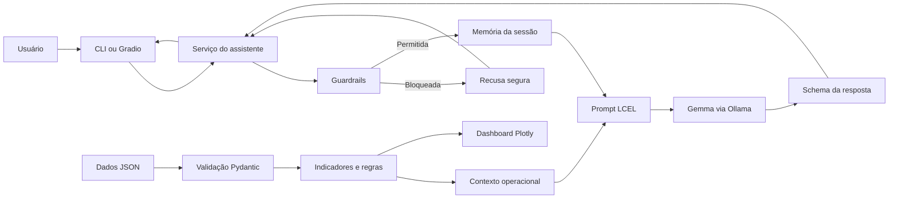

# ChargeGrid Intelligence

**Autores:** Luigi Freire — RM569958 · Victor Vidigal — RM571318 · Gabriel
Savoy — RM568991 · Raphael Tien — RM570261

Assistente gerencial com IA para análise de operações de recarga de veículos
elétricos. O projeto transforma dados operacionais simulados de um eletroposto
com carregadores GoodWe em indicadores, gráficos e recomendações fundamentadas.

O sistema usa o `gemma4:31b-cloud` por meio do Ollama, possui memória isolada por
sessão, guardrails determinísticos, respostas validadas com Pydantic e duas
interfaces: terminal e aplicação web local com Gradio.

## Funcionalidades

- Carregamento e validação de dados operacionais em JSON.
- Cálculo determinístico de demanda, energia, sessões e faturamento.
- Identificação de picos, carregadores críticos e ociosidade.
- Recomendação de throttling preventivo baseada em regras de negócio.
- Dashboard interativo com Plotly.
- Chat em português com respostas estruturadas.
- Memória independente por sessão, limitada por tokens.
- Bloqueio de prompt injection, perguntas fora do escopo e instruções elétricas
  perigosas.
- Interface de terminal e interface web com Gradio.
- Avaliação reproduzível das versões v1 e v2 do system prompt.

## Arquitetura



O modelo interpreta e comunica os resultados. Os cálculos operacionais são
realizados em Python antes da inferência, reduzindo o risco de erros aritméticos
ou de informações inventadas.

## Tecnologias

- Python 3.11 a 3.14
- LangChain e LCEL
- Ollama Cloud
- Gemma 4 31B
- Pydantic
- Gradio
- Plotly
- Pytest
- Ruff

## Estrutura do projeto

```text
.
├── data/
│   └── exemplo_operacao.json       # Dados simulados da operação
├── docs/
│   ├── Estrutura.md                # Arquitetura e organização planejada
│   └── relatorio_modelos.md        # Registro da análise de modelos
├── evals/
│   ├── casos.json                  # Casos de avaliação
│   ├── run_evals.py                # Executor das avaliações
│   ├── baseline_results.json       # Resultado do prompt v1
│   └── sprint3_results.json        # Resultado do prompt v2
├── notebooks/
│   └── Chatbot_ChargeGrid_IA.ipynb # Protótipo original do Colab
├── prompts/
│   ├── system_prompt_v1.md         # Prompt de baseline
│   ├── system_prompt_v2.md         # Prompt atual
│   └── VERSIONS.md                 # Histórico e comparação dos prompts
├── src/
│   ├── chain/
│   │   ├── builder.py              # Chain LCEL e integração com Ollama
│   │   └── memoria.py              # Memória isolada por sessão
│   ├── chargegrid/
│   │   ├── app.py                  # Interface web Gradio
│   │   ├── assistente.py           # Orquestração da aplicação
│   │   ├── cli.py                  # Interface de terminal
│   │   ├── config.py               # Configurações e variáveis de ambiente
│   │   ├── dados.py                # Modelos e validação dos dados
│   │   ├── dashboards.py           # Dashboard Plotly
│   │   └── indicadores.py          # Indicadores e regras de negócio
│   ├── guardrails/
│   │   ├── moderation.py           # Segurança e prompt injection
│   │   └── scope_validator.py      # Validação do escopo
│   └── schemas/
│       └── consulta_recarga.py     # Schema estruturado da resposta
├── tests/                          # Testes automatizados
├── .env.example                    # Exemplo de configuração
└── pyproject.toml                  # Dependências e comandos do projeto
```

## Como executar na sua máquina

### 1. Pré-requisitos

Instale:

- [Git](https://git-scm.com/downloads);
- Python entre 3.11 e 3.14;
- [Ollama](https://ollama.com/download);
- uma conta gratuita no Ollama para acessar o modelo cloud.

Confira as instalações:

```bash
git --version
python --version
ollama --version
```

No Windows, caso `python` não seja reconhecido, tente:

```powershell
py --version
```

### 2. Clone o repositório

```bash
git clone https://github.com/luigiborghetif/ChargeGrid-Intelligence-Prompt-AI-Team7-1CCA-FIAP.git
cd ChargeGrid-Intelligence-Prompt-AI-Team7-1CCA-FIAP
```

### 3. Crie e ative o ambiente virtual

Linux ou macOS:

```bash
python3 -m venv .venv
source .venv/bin/activate
```

Windows PowerShell:

```powershell
py -m venv .venv
.\.venv\Scripts\Activate.ps1
```

Quando o ambiente estiver ativo, o terminal normalmente exibirá `(.venv)` no
início da linha.

### 4. Instale o projeto e as dependências

```bash
python -m pip install --upgrade pip
python -m pip install -e ".[dev]"
```

O modo editável instala as dependências e registra os comandos `chargegrid` e
`chargegrid-web` no ambiente virtual.

### 5. Configure as variáveis de ambiente

Linux ou macOS:

```bash
cp .env.example .env
```

Windows PowerShell:

```powershell
Copy-Item .env.example .env
```

O arquivo já contém valores adequados para a demonstração:

```env
OLLAMA_BASE_URL=http://localhost:11434
OLLAMA_MODEL=gemma4:31b-cloud

CHARGEGRID_DATA_PATH=data/exemplo_operacao.json
CHARGEGRID_PROMPT_PATH=prompts/system_prompt_v2.md

MODEL_TEMPERATURE=0.2
MODEL_TOP_P=0.9
MODEL_MAX_TOKENS=1200
MEMORY_TOKEN_LIMIT=4000
```

Não é necessário criar uma chave de API neste modo. A autenticação acontece no
aplicativo ou CLI local do Ollama. O arquivo `.env` é ignorado pelo Git.

### 6. Entre no Ollama Cloud e prepare o modelo

```bash
ollama signin
ollama pull gemma4:31b-cloud
ollama list
```

O resultado de `ollama list` deve incluir `gemma4:31b-cloud`. Modelos cloud são
processados pelo serviço do Ollama e não exigem uma GPU capaz de carregar os 31
bilhões de parâmetros localmente.

Se o servidor do Ollama não estiver ativo, execute em outro terminal:

```bash
ollama serve
```

Em instalações que iniciam o Ollama automaticamente, esse comando pode informar
que a porta `11434` já está em uso. Nesse caso, o servidor já está funcionando.

### 7. Execute a interface web

Com o ambiente virtual ativo:

```bash
chargegrid-web
```

O navegador abrirá a aplicação local. Se isso não acontecer, acesse:

```text
http://127.0.0.1:7860
```

A aba **Assistente** contém o chat e a aba **Dashboard operacional** apresenta os
gráficos. O botão **Nova conversa** limpa a memória da sessão atual.

Para encerrar o servidor, volte ao terminal onde ele está rodando e pressione:

```text
Ctrl+C
```

### 8. Execute a interface de terminal

```bash
chargegrid
```

Comandos disponíveis durante a conversa:

- `/ajuda`: exibe os comandos;
- `/limpar`: apaga a memória da sessão;
- `/sair`: encerra o programa.

## Exemplos de perguntas

```text
Qual foi o pico de demanda e qual o risco para a operação?
```

```text
Quais carregadores devem receber throttling preventivo?
```

```text
Qual carregador ficou ocioso durante a janela de pico?
```

```text
Qual foi a energia total entregue e existem divergências nos dados?
```

```text
Qual foi o faturamento estimado e quais premissas sustentam esse valor?
```

## Dados utilizados

O projeto usa uma operação simulada disponível em
`data/exemplo_operacao.json`. Ela representa dez carregadores em um shopping,
com demanda contratada de 80 kW e medições entre 08:00 e 22:00.

Existe uma divergência proposital: o resumo informa 342 kWh, enquanto a soma dos
carregadores resulta em 302 kWh. A aplicação usa o valor calculado e registra a
inconsistência na resposta. Isso demonstra validação de qualidade dos dados.

Para testar outro arquivo, mantenha o mesmo schema e altere no `.env`:

```env
CHARGEGRID_DATA_PATH=data/outro_arquivo.json
```

## Testes e qualidade de código

Execute a suíte automatizada:

```bash
python -m pytest -q
```

Verifique lint e formatação:

```bash
ruff check src tests evals/run_evals.py
ruff format --check src tests evals/run_evals.py
```

O estado atual possui 64 testes automatizados cobrindo dados, indicadores,
schema, chain, memória, guardrails, serviço, interfaces e avaliações.

## Avaliações dos prompts

Para executar a comparação completa entre os prompts v1 e v2:

```bash
python evals/run_evals.py --prompt all
```

Para avaliar somente a versão atual:

```bash
python evals/run_evals.py --prompt v2
```

Para recalcular as métricas sobre as respostas já salvas, sem chamar o modelo:

```bash
python evals/run_evals.py --prompt all --recalcular
```

Na execução registrada com `gemma4:31b-cloud`, as duas versões passaram nos dez
casos, com 100% de saída estruturada, aderência aos fatos e guardrails. Consulte
`prompts/VERSIONS.md` para a análise e `evals/` para os resultados completos.

## Solução de problemas

### `ollama: command not found`

Instale o Ollama pelo [site oficial](https://ollama.com/download), feche o
terminal e abra-o novamente.

### `Failed to connect to localhost:11434`

Confirme o serviço:

```bash
ollama list
```

No Linux com instalação como serviço:

```bash
sudo systemctl restart ollama
```

### `bind: address already in use`

A porta `11434` já está ocupada, geralmente porque o Ollama já iniciou. Não abra
uma segunda instância; confirme com `ollama list` e execute a aplicação.

### Modelo não encontrado

Confira se o identificador contém `:` e prepare o modelo novamente:

```bash
ollama pull gemma4:31b-cloud
```

### Erro 401, 402 ou pedido de login

Execute `ollama signin` e confirme que a conta possui acesso ao modelo. A
disponibilidade de modelos e os limites gratuitos podem mudar ao longo do tempo.

### O comando `chargegrid-web` não existe

Ative o `.venv` e repita:

```bash
python -m pip install -e ".[dev]"
```

Também é possível iniciar diretamente:

```bash
python -m chargegrid.app
```

## Limitações

- Os dados são simulados e carregados de um arquivo local.
- Não existe integração com carregadores físicos ou telemetria em tempo real.
- A memória permanece somente enquanto o processo está em execução.
- O sistema recomenda ações, mas não controla equipamentos.
- Estimativas dependem das premissas presentes nos dados.
- Intervenções elétricas exigem avaliação de um profissional habilitado.
- O modelo cloud depende de conexão com a internet e da disponibilidade do
  serviço Ollama.
