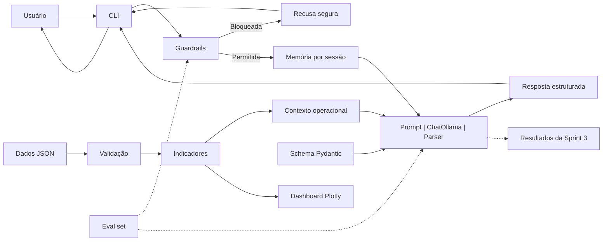

# Estrutura

chargegrid-intelligence/
├── README.md
├── pyproject.toml
├── .gitignore
├── .env.example
│
├── data/
│   └── exemplo_operacao.json
│
├── prompts/
│   ├── system_prompt_v1.md
│   ├── system_prompt_v2.md
│   ├── briefing_v1.md
│   └── VERSIONS.md
│
├── src/
│   ├── chargegrid/
│   │   ├── __init__.py
│   │   ├── config.py
│   │   ├── dados.py
│   │   ├── indicadores.py
│   │   ├── dashboards.py
│   │   ├── assistente.py
│   │   └── cli.py
│   │
│   ├── chain/
│   │   ├── __init__.py
│   │   ├── builder.py
│   │   └── memoria.py
│   │
│   ├── schemas/
│   │   ├── __init__.py
│   │   └── consulta_recarga.py
│   │
│   └── guardrails/
│       ├── __init__.py
│       ├── scope_validator.py
│       └── moderation.py
│
├── evals/
│   ├── casos.json
│   ├── run_evals.py
│   ├── baseline_results.json
│   └── sprint3_results.json
│
├── notebooks/
│   └── Chatbot_ChargeGrid_IA.ipynb
│
├── tests/
│   ├── test_dados.py
│   ├── test_indicadores.py
│   ├── test_schema.py
│   ├── test_memoria.py
│   └── test_guardrails.py
│
└── docs/
    ├── Estrutura.md
    ├── relatorio_modelos.md
    ├── relatorio_evolucao.pdf
    └── classificacao_outputs_sprint2.pdf
